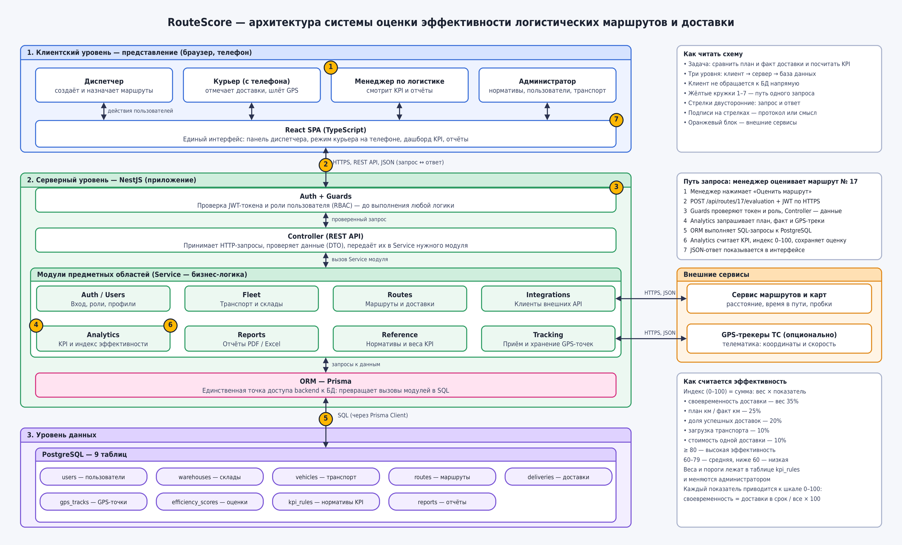
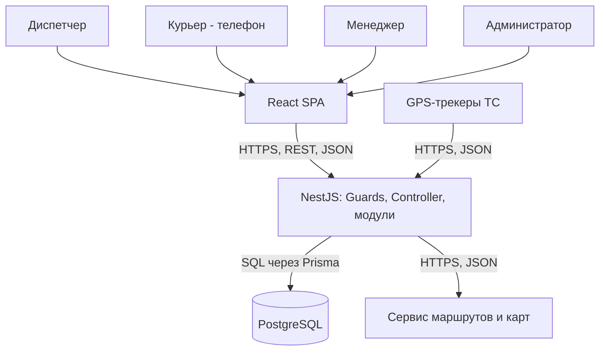

# RouteScore — оценка эффективности логистических маршрутов и доставки

Лабораторная работа №1 «Проектирование архитектуры клиент-серверного приложения».
Курс «Разработка клиент-серверных приложений». Программный код в этой работе не пишется: результат — архитектурная документация.

## Предметная область

Выбрана собственная тема: оценка эффективности логистических маршрутов и доставки (курьерская и транспортная доставка по городу и региону).

**Роли (4, права различаются):**

| Роль | Что может |
| --- | --- |
| Диспетчер | создавать маршруты, добавлять в них доставки, назначать курьера и транспорт, видеть статусы и проблемные маршруты |
| Курьер | видеть **только свои** маршруты, отмечать статус доставок, передавать GPS-координаты |
| Менеджер по логистике | запрашивать оценку эффективности, сравнивать план и факт, смотреть дашборд KPI, формировать отчёты |
| Администратор | управлять пользователями, транспортом, складами, а также нормативами и весами KPI |

**Сущности (9, связаны между собой):**
пользователь (`users`), склад (`warehouses`), транспортное средство (`vehicles`), маршрут / рейс (`routes`), доставка — точка маршрута (`deliveries`), GPS-точка (`gps_tracks`), оценка эффективности (`efficiency_scores`), норматив KPI (`kpi_rules`), отчёт (`reports`).
Связи: маршрут начинается на складе и выполняется одним курьером на одном транспортном средстве; в маршруте несколько доставок в заданном порядке; GPS-точки относятся к маршруту; оценка строится по маршруту и хранит снимок применённых нормативов; отчёт строится по оценкам за период.

**Операции (12):**
1. вход в систему;
2. создание маршрута;
3. добавление и изменение доставок в маршруте;
4. назначение курьера и транспорта;
5. отметка статуса доставки (доставлено / не доставлено / с задержкой);
6. передача GPS-координат;
7. расчёт эффективности маршрута (KPI и индекс);
8. сравнение плана и факта по маршруту;
9. просмотр дашборда KPI за период;
10. формирование отчёта (PDF / Excel);
11. управление нормативами и весами KPI;
12. управление пользователями, транспортом и складами.

Вывод: область подходит (≥2 ролей, ≥5 сущностей, ≥8 операций).

## Описание системы

RouteScore — веб-система, которая оценивает, насколько эффективно выполнены логистические маршруты и доставки. Диспетчер создаёт маршрут: выбирает склад, добавляет точки доставки и назначает курьера и транспорт, а система получает от сервиса карт плановый путь и время. Во время рейса курьер с телефона отмечает статусы доставок и передаёт GPS-координаты, поэтому в системе накапливаются фактические данные. Менеджер по логистике запрашивает оценку и получает пять показателей (своевременность, эффективность пути, успешность доставок, загрузку транспорта и стоимость доставки) и итоговый индекс от 0 до 100. Система заменяет ручное сравнение «план — факт» в таблицах: формула и нормативы единые для всех маршрутов, результат воспроизводим и хранится в истории. Права разграничены: курьер видит только свои маршруты, диспетчер управляет маршрутами, а нормативы KPI меняет только администратор.

### Упрощённая модель расчёта

Каждый показатель приводится к шкале 0–100:

| Показатель | Формула | Вес |
| --- | --- | --- |
| Своевременность | доставки в срок / все доставки × 100 | 35% |
| Эффективность пути | плановые км / фактические км × 100 (не более 100) | 25% |
| Успешность доставок | доставлено / запланировано × 100 | 20% |
| Загрузка транспорта | фактическая загрузка / вместимость × 100 (не более 100) | 10% |
| Стоимость доставки | норматив стоимости / фактическая стоимость × 100 (не более 100) | 10% |

```
Индекс = 0.35 × Своевременность + 0.25 × Путь + 0.20 × Успешность + 0.10 × Загрузка + 0.10 × Стоимость
```

Категории: 80–100 — высокая, 60–79 — средняя, ниже 60 — низкая эффективность. Веса и нормативы лежат в таблице `kpi_rules`. Это учебная модель.

## Команда

Азат, группа ИС-21 (индивидуальная работа).

## Роли и сценарии

| ID | Роль | Сценарий | Результат |
| --- | --- | --- | --- |
| UC1 | Диспетчер | Создаёт маршрут: выбирает склад, добавляет доставки, назначает курьера и транспорт | Маршрут сохранён со статусом «запланирован», получены плановое расстояние и время |
| UC2 | Курьер | Отмечает статус доставки и передаёт GPS-координаты во время рейса | Сохранены фактическое время (по часам сервера) и координаты |
| UC3 | Менеджер по логистике | Запрашивает оценку эффективности завершённого маршрута | Сохранена оценка: пять показателей, индекс и категория |
| UC4 | Менеджер по логистике | Смотрит дашборд за период, сравнивает план и факт и формирует отчёт | Графики, таблица сравнения и файл PDF / Excel |
| UC5 | Диспетчер | Фильтрует маршруты по дате, статусу и индексу, находит проблемные (индекс ниже 60) | Список маршрутов для разбора |
| UC6 | Администратор | Меняет веса и нормативы KPI, управляет транспортом и пользователями | Новые значения применяются к следующим расчётам, старые оценки не пересчитываются |

## Архитектура



Цифры 1–7 на схеме показывают путь запроса «менеджер оценивает маршрут» (подробно — в [docs/request-lifecycle.md](docs/request-lifecycle.md)). Ответ возвращается тем же путём.

Исходник схемы: `docs/architecture.drawio`.
Описание компонентов: [docs/components.md](docs/components.md).

Схема в Mermaid (дополнение к изображению):



## Обоснование решений

**1. Почему трёхуровневая архитектура и что было бы при прямой работе клиента с БД?**
Выбрана схема «интерфейс → backend → база данных». Backend нужен, чтобы пароль от БД не попадал на телефон курьера или в браузер, а права и расчёт проверялись в одном месте. Если бы клиент работал с PostgreSQL напрямую, любой курьер мог бы прочитать чужие маршруты и геоданные коллег, изменить статусы доставок и веса KPI: проверок ролей между клиентом и данными не было бы.

**2. Какие данные хранятся в БД, а какие у клиента?**
В БД хранятся пользователи (с хэшами паролей), склады, транспорт, маршруты, доставки, GPS-точки, оценки, нормативы и отчёты: всё, что должно сохраняться и быть общим. У клиента лежат только JWT-токен и состояние интерфейса (выбранный период, фильтры, открытая форма). Если бы оценки или статусы доставок хранились на устройстве, их можно было бы подделать, а при потере телефона они бы пропали.

**3. Где применён stateless и как сервер узнаёт, кто отправил запрос?**
Каждый запрос содержит заголовок `Authorization: Bearer <JWT>`, в токене есть идентификатор пользователя и роль, а Guard проверяет подпись и срок действия. Сессий в памяти сервера нет. Для этой системы это особенно важно: GPS-точки приходят часто (например, раз в 10–30 секунд от каждого курьера), поэтому нужно уметь запускать несколько экземпляров backend, и любой из них должен обработать любой запрос.

**4. Почему монолит и когда стали бы разделять систему?**
Выбран модульный монолит: одно приложение NestJS с модулями Auth, Fleet, Routes, Tracking, Analytics, Reports, Reference и Integrations. Проект ведёт один человек, расчёту нужны данные нескольких модулей в одной транзакции, а развёртывание одного приложения проще. Если поток GPS-точек или объём расчётов вырастет (сотни курьеров, пакетный пересчёт за месяц), модули Tracking и Analytics можно вынести в отдельные сервисы с очередью сообщений: границы модулей для этого уже выделены.

**5. Какие проверки выполняются на сервере и почему не только на клиенте?**
На сервере проверяются: токен и роль (Guards), права на конкретный маршрут (курьер меняет только свои доставки), корректность данных (широта в диапазоне −90…90, долгота −180…180, допустимые статусы), а также сама формула KPI. Время отметки доставки ставит сервер, а не телефон, иначе курьер мог бы «исправить» опоздание. Проверки в браузере легко обойти запросом через curl, поэтому клиентские проверки нужны только для удобства.

## Риски

| Риск | Место на схеме | Последствие | Как снизить |
| --- | --- | --- | --- |
| Сервис маршрутов и карт недоступен или исчерпан лимит запросов | Integrations → Сервис маршрутов и карт | Нельзя получить плановый путь и время для нового маршрута | Сохранять маршрут как черновик, временно считать расстояние по прямой с пометкой, повторять запрос позже, кэшировать построенные маршруты |
| Пропадает связь у курьера или GPS даёт неточные координаты | Курьер → Tracking, таблица `gps_tracks` | В треке пропуски и выбросы, фактический пробег посчитан неверно | Фильтровать выбросы, помечать оценку как «данные неполные», разрешить диспетчеру подтвердить отметку вручную |
| Большой поток GPS-точек перегружает backend и БД | Tracking, PostgreSQL | Медленные ответы, задержки в интерфейсе | Принимать точки пакетами, индекс по маршруту и времени, ограничить частоту отправки, хранить сырые точки ограниченный срок; при росте вынести Tracking в отдельный сервис |
| Ошибочные веса или нормативы KPI | Reference, таблица `kpi_rules` | Искажённые оценки по всем маршрутам | Проверять, что сумма весов равна 100%, хранить снимок применённых весов в каждой оценке, вести журнал изменений, доступ только у администратора |
| Подбор пароля или кража токена | Auth + Guards, канал клиент → backend | Доступ к чужим маршрутам и геоданным сотрудников | Хэширование паролей (bcrypt), ограничение числа попыток входа, HTTPS, короткий срок жизни JWT, доступ к трекам только у диспетчера и менеджера |
| База данных недоступна или данные потеряны | PostgreSQL, ORM | Система не работает, возможна потеря истории | Регулярные резервные копии, понятное сообщение об ошибке (503), настройка пула соединений |
